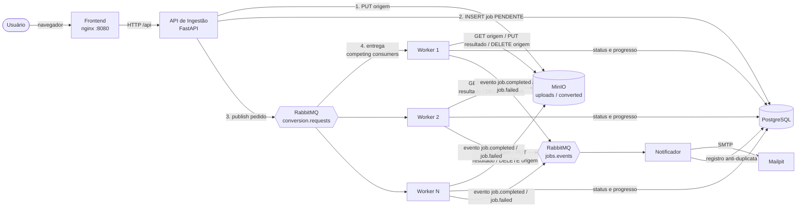
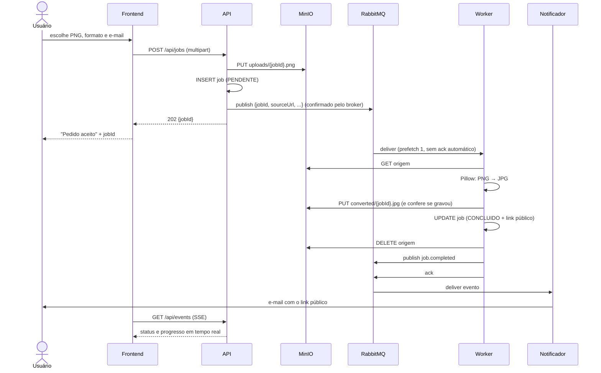

# Conversor PNG → JPG com processamento assíncrono

Sistema distribuído de conversão de imagens. O usuário envia um PNG pela
interface web, recebe o `jobId` na hora e a conversão acontece em segundo
plano, em workers que consomem uma fila do **RabbitMQ**. Os arquivos ficam no
**MinIO** e o usuário recebe por e-mail o link público do JPG.

> Formato escolhido para o trabalho (autorizado pelo professor): **PNG → JPG**.
> O worker usa um registro de conversores, então incluir outro formato
> (ex.: WAV → MP3 com FFmpeg) exige apenas uma função nova e uma linha no
> contrato. Nenhuma outra parte do sistema muda.

---

## Sumário

1. [Arquitetura](#arquitetura)
2. [Como executar](#como-executar)
3. [Endereços úteis](#endereços-úteis)
4. [Variáveis de ambiente](#variáveis-de-ambiente)
5. [Buckets do MinIO](#buckets-do-minio)
6. [Escalando os workers](#escalando-os-workers)
7. [Contrato das mensagens](#contrato-das-mensagens)
8. [Garantias de entrega e idempotência](#garantias-de-entrega-e-idempotência)
9. [Testes automatizados](#testes-automatizados)
10. [Benchmark: 1 worker vs N workers](#benchmark-1-worker-vs-n-workers)
11. [Roteiro da demonstração gravada](#roteiro-da-demonstração-gravada)
12. [Estrutura do repositório](#estrutura-do-repositório)
13. [Limitações conhecidas](#limitações-conhecidas)

---

## Arquitetura



Cada componente roda no seu próprio container. **A API não conhece os
workers e os workers não conhecem a API**: a única interface entre eles é o
contrato definido em `shared/mediaconv_common/contract.py`.

### Fluxo de um pedido



### Topologia do RabbitMQ

| Exchange / fila | Tipo | Função |
|---|---|---|
| `conversion` → `conversion.requests` | direct, fila com prioridade (0-10) | pedidos de conversão; arquivos menores têm prioridade maior |
| `conversion.retry` | fila sem consumidor, TTL por mensagem | espera antes de nova tentativa; ao expirar volta para `conversion` |
| `conversion.dlx` → `conversion.dlq` | direct | falhas definitivas (dead letter) |
| `jobs.events` → `notifications` | topic (`job.*`), quorum queue | eventos de término para o notificador |
| `notifications.dlx` → `notifications.dlq` | fanout | e-mails que falharam 5 vezes |

### Por que RabbitMQ e não Kafka

O problema é uma **fila de tarefas**: cada pedido deve ser processado uma
vez, por um worker, e confirmado individualmente. O RabbitMQ oferece isso de
forma nativa:

- **Competing consumers:** N workers na mesma fila, e o broker reparte as mensagens entre eles.
- **Ack individual:** cada mensagem é confirmada separadamente. Se um worker morre, só a mensagem dele volta para a fila.
- **Dead-letter exchange:** a DLQ existe sem código extra.
- **Recursos usados na pontuação extra:** filas com prioridade e TTL por mensagem, que implementam o retry com atraso.
- **Painel web:** mostra as filas, o que ajuda na demonstração.

No Kafka, o paralelismo fica limitado ao número de partições, o commit de
offset é sequencial por partição (uma mensagem lenta segura as seguintes) e
retry/DLQ precisam ser montados à mão com tópicos extras. O Kafka seria a
escolha certa para *streaming* de eventos com retenção e replay, o que não é
o caso aqui.

---

## Como executar

**Pré-requisito:** Docker com o plugin Compose v2 (`docker compose version`).

```bash
git clone <url-do-repositorio>
cd conversor-midia
docker compose up --build
```

Pronto: é só isso. O primeiro build demora alguns minutos. A ordem de subida é
controlada por *healthchecks*:

1. RabbitMQ, MinIO (Silo), Postgres e Mailpit sobem.
2. O `minio-init` cria os buckets e as políticas, e depois encerra (status `Exited (0)` é o esperado).
3. API, workers e notificador sobem. Cada um declara a topologia do RabbitMQ de forma idempotente.
4. O frontend sobe quando a API responde ao healthcheck.

Abra **http://localhost:8080**.

Para parar: `docker compose down`. Para apagar também os dados (filas, banco
e arquivos): `docker compose down -v`.

> **Por que a imagem `pgsty/silo` e não `minio/minio`:** a MinIO encerrou a
> edição comunitária e, em setembro de 2026, removeu as imagens `minio/minio` e
> `minio/mc` do Docker Hub e do quay.io (o pull falha com `unauthorized`). O
> compose usa o **Silo**, fork comunitário do MinIO mantido pela Pigsty, com a
> mesma API S3, as mesmas variáveis `MINIO_*` e o mesmo formato de dados. Para
> o código Python nada muda: a biblioteca continua sendo a `minio-py`. A
> configuração dos buckets também deixou de depender da imagem do `mc`: agora é
> um script Python (`infra/minio/setup.py`).

### Problemas comuns

**`Bind for 0.0.0.0:XXXX failed: port is already allocated`:** outro programa
já usa essa porta no seu computador. Só as portas abertas no navegador são
publicadas (8080, 8000, 15672, 9000, 9001 e 8025). Banco, AMQP e SMTP ficam
apenas na rede interna do Docker, justamente para não conflitar com um
PostgreSQL ou RabbitMQ instalado localmente. Para descobrir quem ocupa uma
porta:

```bash
# Windows (PowerShell)
netstat -ano | findstr :8080
# Linux / macOS
lsof -i :8080
```

Feche o programa ou troque a porta do lado esquerdo no compose (por exemplo,
`"8081:80"` no frontend) e rode `docker compose up -d` de novo.

**Ver o banco de dados:** `docker compose exec postgres psql -U conversor`
(depois, por exemplo, `select original_filename, status, worker_id from jobs;`).

**Ver os logs de um serviço:** `docker compose logs -f worker` (ou `api`,
`notifier`, `minio-init`).

---

## Endereços úteis

| Serviço | URL | Login |
|---|---|---|
| Interface | http://localhost:8080 | — |
| API (docs interativas) | http://localhost:8000/docs | — |
| RabbitMQ (painel) | http://localhost:15672 | `conversor` / `conversor123` |
| MinIO (console) | http://localhost:9001 | `minioadmin` / `minioadmin123` |
| Mailpit (caixa de entrada) | http://localhost:8025 | — |
| Links públicos dos JPGs | http://localhost:9000/converted/{jobId}.jpg | — |

### Endpoints da API

| Método e rota | Descrição |
|---|---|
| `POST /api/jobs` | multipart: `file`, `targetFormat`, `email`. Responde **202** com `jobId` |
| `GET /api/jobs/{jobId}` | estado do pedido (PENDENTE, PROCESSANDO, CONCLUIDO, ERRO) |
| `GET /api/jobs` | pedidos recentes |
| `GET /api/events` | stream SSE com as mudanças de todos os pedidos |
| `GET /api/jobs/{jobId}/events` | stream SSE de um pedido (encerra no estado final) |
| `GET /api/metrics` | tamanho das filas, tempo médio, taxa de erro, conversões por worker |
| `GET /api/formats` | conversões suportadas |

---

## Variáveis de ambiente

Todas têm valor padrão no `docker-compose.yml`. Para alterar, copie
`.env.example` para `.env` e edite; o Compose lê o `.env` automaticamente.

| Variável | Padrão | Uso |
|---|---|---|
| `WORKER_REPLICAS` | `2` | quantidade inicial de workers |
| `CONVERSION_DELAY_SECONDS` | `8` | atraso artificial por conversão (ver abaixo) |
| `MAX_ATTEMPTS` | `3` | tentativas antes da DLQ |
| `RETRY_DELAY_MS` | `5000` | espera entre tentativas (TTL na fila de retry) |
| `MAX_UPLOAD_MB` | `20` | tamanho máximo do upload |
| `CONVERTED_EXPIRATION_DAYS` | `7` | lifecycle: JPGs são apagados após N dias |
| `MINIO_PUBLIC_URL` | `http://localhost:9000` | base dos links enviados por e-mail |
| `RABBITMQ_USER` / `RABBITMQ_PASSWORD` | `conversor` / `conversor123` | broker |
| `MINIO_ROOT_USER` / `MINIO_ROOT_PASSWORD` | `minioadmin` / `minioadmin123` | storage |
| `POSTGRES_DB` / `POSTGRES_USER` / `POSTGRES_PASSWORD` | `conversor` | banco |
| `SMTP_HOST` / `SMTP_PORT` / `SMTP_FROM` | `mailpit` / `1025` | e-mail |

**Sobre `CONVERSION_DELAY_SECONDS`:** converter um PNG em JPG leva
milissegundos. Sem um atraso seria impossível derrubar um worker "no meio da
conversão" ou medir a diferença entre 1 e N workers. O atraso é um recurso
de demonstração, declarado como tal. Use `0` para medir o tempo real da
conversão.

---

## Buckets do MinIO

Não há passo manual: o container `minio-init` executa
`infra/minio/setup.py` a cada `docker compose up`. O script espera o storage
aceitar conexões, é idempotente e faz três coisas:

- **`uploads`:** cria o bucket privado dos arquivos de origem, que são temporários.
- **`converted`:** cria o bucket dos resultados, com leitura pública anônima, apenas para download (`set_bucket_policy` com `s3:GetObject`).
- **Lifecycle:** aplica uma regra que apaga os JPGs após `CONVERTED_EXPIRATION_DAYS` dias (`set_bucket_lifecycle`).

**Por que leitura pública em vez de URL pré-assinada:** a assinatura de uma
URL pré-assinada inclui o host. Gerada dentro do Docker, ela aponta para
`minio:9000`, que o navegador não resolve, e trocar o host invalida a
assinatura. Com a política pública, o link é simplesmente
`MINIO_PUBLIC_URL/converted/{jobId}.jpg`. O `jobId` é um UUID aleatório, o
que torna o link impraticável de adivinhar.

Para recriar os buckets manualmente: `docker compose run --rm minio-init`.

---

## Escalando os workers

```bash
# durante a execução, sem rebuild e sem mudar código:
docker compose up -d --scale worker=4

# conferir as réplicas
docker compose ps worker

# ou definir o padrão no .env
WORKER_REPLICAS=4
```

O serviço `worker` não define `container_name` nem `ports` justamente para
permitir várias réplicas. Cada worker se identifica pelo hostname do
container (12 caracteres). Esse identificador aparece na interface, no banco
e no painel "Concluídos por worker". Para associar o identificador ao
container, use `docker ps`.

**Por que não há conversão duplicada:** cada mensagem é entregue a um único
consumidor por vez (`prefetch_count=1` + ack manual). A proteção extra contra
duplicatas está descrita na próxima seção.

---

## Contrato das mensagens

**Pedido de conversão** (`conversion.requests`), exatamente o formato do enunciado:

```json
{
  "jobId": "9f2c1a84-3b77-4e5a-9d21-6c0a8f4b1e30",
  "sourceUrl": "http://minio:9000/uploads/9f2c1a84-3b77-4e5a-9d21-6c0a8f4b1e30.png",
  "sourceType": "image",
  "sourceFormat": "png",
  "targetFormat": "jpg",
  "notifyEmail": "aluno@exemplo.com",
  "requestedAt": "2026-03-14T18:22:05Z",
  "attempt": 1
}
```

**Evento de término** (`jobs.events`, routing key `job.completed` ou `job.failed`):

```json
{
  "jobId": "9f2c1a84-3b77-4e5a-9d21-6c0a8f4b1e30",
  "status": "CONCLUIDO",
  "notifyEmail": "aluno@exemplo.com",
  "originalFilename": "logo.png",
  "targetFormat": "jpg",
  "publicUrl": "http://localhost:9000/converted/9f2c1a84-3b77-4e5a-9d21-6c0a8f4b1e30.jpg",
  "error": null,
  "workerId": "3f9a1c2b7d10",
  "finishedAt": "2026-03-14T18:22:14Z"
}
```

**Por que o binário não vai na fila:** uma mensagem de ~400 bytes mantém o
broker leve. Filas com arquivos de megabytes esgotariam memória e disco do
RabbitMQ, deixariam as retentativas caras (o arquivo seria copiado de novo a
cada retry) e misturariam dois papéis: o broker coordena, o object storage
armazena. Mensagens fora do contrato (JSON inválido, campo faltando,
conversão não suportada) vão direto para a DLQ, porque tentar de novo não
resolveria.

---

## Garantias de entrega e idempotência

### Do lado da API (producer)

- **Durabilidade:** exchanges e filas duráveis e mensagens persistentes (`delivery_mode=2`) sobrevivem a um restart do broker.
- **Publisher confirms:** a API só responde 202 depois que o RabbitMQ confirmou a gravação. Com `mandatory=True`, uma mensagem sem rota vira erro em vez de sumir.
- **Falha na publicação:** a API responde 503, marca o job como ERRO e remove a origem.

### Do lado do worker (consumer)

- **Ack manual, só no fim:** o ack vem depois de o resultado estar gravado e conferido, o banco atualizado, a origem apagada e o evento publicado (também com confirmação). Se o container morre antes, o RabbitMQ reentrega a mensagem a outro worker, com a flag `redelivered`.
- **Retentativas:** uma falha temporária (MinIO fora do ar, erro de rede) republica a mensagem com `attempt + 1` na fila `conversion.retry`, com TTL de `RETRY_DELAY_MS`. Ao expirar, o próprio RabbitMQ a devolve à fila principal. O worker não fica parado esperando.
- **DLQ:** na tentativa `MAX_ATTEMPTS`, o job vira ERRO, o usuário recebe um e-mail explicando a falha e a mensagem é rejeitada (`requeue=False`), indo para `conversion.dlq`. A origem é **preservada** para diagnóstico.
- **Erros permanentes:** arquivo corrompido ou que não é PNG vai direto para a DLQ, sem gastar tentativas.
- **Worker que morre sempre:** a contagem de tentativas fica no banco (`attempts`), não só na mensagem. Uma imagem que derruba o worker toda vez também para no limite.

### Idempotência (chave: `jobId`)

| Situação | O que acontece |
|---|---|
| Mensagem de um job já CONCLUIDO chega de novo | não converte; refaz apenas a finalização (apagar a origem e publicar o evento) e dá ack |
| Duas cópias da mesma mensagem ao mesmo tempo | *advisory lock* do Postgres com o jobId: a segunda cópia encontra o lock ocupado e é descartada |
| Worker morreu depois de gravar o JPG e antes do ack | na reentrega, o JPG já existe no MinIO e a conversão é pulada |
| Conversão refeita por qualquer motivo | o resultado tem nome fixo (`converted/{jobId}.jpg`) e é sobrescrito, nunca duplicado |
| Evento de término chega duas vezes ao notificador | a chave primária de `notifications.job_id` impede o segundo envio |

O lock é *da sessão do banco*: se o worker morre, a conexão cai e o Postgres
libera o lock sozinho. Um job nunca fica "preso" por um worker morto.

### Notificador

- **Consumidor separado:** se o SMTP cair, as conversões continuam e os e-mails esperam na fila.
- **Transação:** a reserva em `notifications` e o envio acontecem na mesma transação. Se o envio falha, a reserva é desfeita e a mensagem volta para a fila.
- **Limite de entregas:** a fila `notifications` é uma *quorum queue* com `x-delivery-limit=5`. Depois de 5 entregas sem sucesso, a mensagem vai para `notifications.dlq`.

---

## Testes automatizados

São 37 testes que cobrem o publisher (API), o consumer (regras do worker), o
conversor e o notificador. Eles usam dublês em memória e não precisam de
Docker.

```bash
python -m venv .venv
source .venv/bin/activate          # Windows: .venv\Scripts\activate
pip install -r requirements-dev.txt
pytest -v
```

Cenários cobertos, entre outros: mensagem duplicada, reentrega após queda,
lock ocupado por outro worker, retry com incremento de tentativa, desistência
após o limite com origem preservada, imagem corrompida sem retentativa, PNG
transparente virando JPG com fundo branco, validações da API, broker fora do
ar (503) e envio único de e-mail.

---

## Benchmark: 1 worker vs N workers

Com o ambiente no ar (e as dependências de `requirements-dev.txt` instaladas):

```bash
docker compose up -d --scale worker=1
python scripts/benchmark.py --count 12

docker compose up -d --scale worker=2
python scripts/benchmark.py --count 12

docker compose up -d --scale worker=4
python scripts/benchmark.py --count 12
```

O script gera PNGs, envia todos de uma vez, espera que terminem e imprime o
tempo total, o throughput, a distribuição por worker e uma linha pronta para
a tabela do relatório:

| Workers | Pedidos | Tempo total | Throughput | Tempo médio por conversão |
|---|---|---|---|---|
| 1 | 12 | ... | ... | ... |
| 2 | 12 | ... | ... | ... |
| 4 | 12 | ... | ... | ... |

Com `CONVERSION_DELAY_SECONDS=8`, o esperado é algo próximo de 12 × 8 / N
segundos. Em um teste de desenvolvimento com 8 pedidos, 2 workers e 3 s de
atraso, o resultado foi 13,5 s, com 4 pedidos por worker.

---

## Roteiro da demonstração gravada

Deixe abertas quatro abas (interface, RabbitMQ, MinIO e Mailpit) e um
terminal com `docker compose logs -f worker`.

1. **Upload e jobId imediato.** Envie um PNG pela interface. O jobId aparece
   em milissegundos, antes de a conversão começar.
2. **Mensagem na fila.** Pare os workers (`docker compose stop worker`), envie
   mais 3 PNGs e mostre no RabbitMQ, em *Queues* → `conversion.requests`, as
   mensagens paradas. Em *Get messages* dá para exibir o JSON do contrato.
   Depois suba os workers (`docker compose start worker`).
3. **Dois workers em paralelo.** Selecione 6 arquivos de uma vez. Na interface,
   dois pedidos ficam "Processando" ao mesmo tempo, em workers diferentes. Nos
   logs, os dois containers aparecem intercalados.
4. **Ciclo de vida dos arquivos.** No console do MinIO: o JPG está em
   `converted` e o PNG já não está em `uploads`.
5. **E-mail.** No Mailpit, abra o e-mail e clique no link: o JPG abre.
6. **Queda de worker.** Envie alguns arquivos e, enquanto um estiver
   "Processando", derrube o worker que está com ele:
   ```bash
   docker compose ps worker                      # veja os nomes
   docker kill conversor-midia-worker-1
   ```
   Nos logs, outro worker registra `REENTREGA`. Na interface, o pedido termina
   com "tentativa 2", sem arquivo duplicado e com um único e-mail. (O Docker
   pode reiniciar o container derrubado por causa da *restart policy*; isso
   não interfere no teste.)
7. **Extra: retry e DLQ.** Envie um arquivo `.png` corrompido (por exemplo, um
   PNG verdadeiro truncado com um editor). Ele vai para `conversion.dlq`, o
   pedido fica como Erro e chega um e-mail explicando o motivo. Para mostrar
   uma retentativa, rode `docker compose stop minio` com pedidos na fila,
   espere uma falha ("aguardando nova tentativa") e depois
   `docker compose start minio`: o pedido conclui na tentativa seguinte.

---

## Estrutura do repositório

```
conversor-midia/
├── docker-compose.yml          # todo o ambiente
├── .env.example                # variáveis (opcional)
├── shared/mediaconv_common/    # usado por todos os serviços Python
│   ├── contract.py             # contrato das mensagens (a única interface)
│   ├── topology.py             # exchanges e filas do RabbitMQ
│   ├── storage.py              # MinIO
│   └── settings.py             # variáveis de ambiente, logs, pool do Postgres
├── api/ingest_api/             # PRODUCER
│   ├── main.py                 # rotas FastAPI e validação
│   ├── publisher.py            # publicação com publisher confirms
│   └── repository.py           # tabela jobs
├── worker/converter_worker/    # CONSUMER
│   ├── main.py                 # loop do RabbitMQ: ack / retry / reject
│   ├── processor.py            # regras de idempotência e falha (testável)
│   ├── converters.py           # registro de conversores (Pillow)
│   └── repository.py           # lock e atualização de status
├── notifier/notifier_service/  # 2º CONSUMER
│   ├── main.py
│   ├── handler.py              # no máximo um e-mail por job
│   └── mailer.py               # e-mail em texto e HTML
├── frontend/                   # nginx + HTML/CSS/JS
├── infra/
│   ├── minio/setup.py          # buckets, política pública, lifecycle
│   └── postgres/init.sql       # tabelas jobs e notifications
├── tests/                      # pytest
├── scripts/benchmark.py        # evidência de escalabilidade
└── docs/                       # relatório técnico
```

---

## Limitações conhecidas

O que faríamos diferente em produção:

- **Escrita dupla na API.** A API grava no banco e depois publica no broker.
  Se ela morrer entre os dois passos, o job fica PENDENTE sem mensagem. Em
  produção, usaríamos o padrão *transactional outbox*: gravar a mensagem numa
  tabela na mesma transação do job e publicar a partir dela.
- **E-mail at-least-once.** Se o notificador morrer depois de o SMTP aceitar
  o e-mail e antes do COMMIT, o e-mail pode sair duas vezes. Entrega
  exatamente-uma-vez entre dois sistemas independentes (banco e SMTP) não é
  possível sem coordenação distribuída. A janela de risco é de milissegundos.
- **Progresso por polling.** O stream SSE consulta o banco a cada 0,5 s. Com
  muitos usuários, o ideal seria o worker publicar eventos de progresso no
  broker e a API repassá-los aos navegadores.
- **Banco compartilhado.** Os três serviços usam o mesmo Postgres (cada um com
  suas tabelas). Em microsserviços estritos, cada serviço teria o seu, e o
  status dos jobs seria atualizado pela API a partir de eventos.
- **Segurança.** Não há autenticação: qualquer pessoa pode consultar qualquer
  jobId. As senhas padrão estão no compose, e não há TLS nem antivírus nos
  uploads.
- **Reconexão.** Se a conexão com o RabbitMQ cair, o worker encerra e o Docker
  o reinicia (`restart: unless-stopped`). Uma reconexão interna seria mais
  suave.
- **Retry com atraso fixo.** Um *backoff* exponencial exigiria uma fila de
  espera por nível de atraso, porque o TTL só expira mensagens no início da
  fila.
